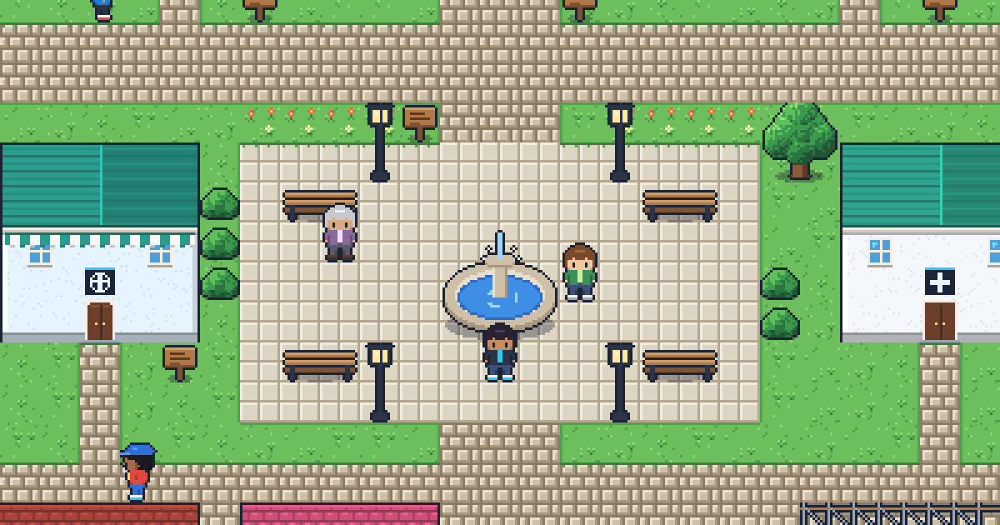

# Ciudad Primada · Portafolio de Jhossua



Mi portafolio como un RPG 2D de consola portátil: arriba, **Ciudad Primada**, un pueblo dibujado con three.js donde
cada edificio es uno de mis proyectos; abajo, una pantalla "táctil" con todo el portafolio en HTML para quien prefiera
ir directo al grano.

- Calles con nombres de la Zona Colonial de Santo Domingo, el Malecón y el Caribe al sur.
- Estaciones que rotan cada mes y día/noche según tu reloj (o a tu gusto en Opciones).
- Piloto automático: toca un edificio en el mapa y el personaje camina solo hasta la puerta.
- Teclado, cruceta en pantalla y mando. Accesible con lector de pantalla y sin JavaScript.
- Todo el arte (personajes, edificios, tiles) es original y se genera con código.

## Empezar

Requisitos: Node 24.8+ y pnpm 12.

```bash
pnpm install
pnpm dev          # http://localhost:4321
```

| Controles | Teclado | Pantalla |
| --- | --- | --- |
| Moverse | Flechas o WASD | Cruceta |
| Hablar, leer, aceptar | Z o Enter | A |
| Cancelar / correr (mantener) | X o Shift | B |
| Menú / mapa | P / M | Start / Select |

## Calidad

```bash
pnpm check            # TypeScript 7 + astro check + Biome
pnpm test             # Vitest: unit, componentes y funcionales
pnpm test:e2e         # TesterArmy e2e (escritorio y móvil)
pnpm test:e2e:agent   # e2e con agente (necesita AI_GATEWAY_API_KEY)
```

## Stack

Astro 7 · three.js · Tailwind CSS 4 · TypeScript 7 (estricto) · pnpm · Vitest 5 · TesterArmy e2e · Biome.

La guía de arquitectura y convenciones está en [AGENTS.md](AGENTS.md).

## Proyectos en el pueblo

Administrador de Licencias, MiMes, Managero RD, Postesados JHP, Maps For Mom, Tenax Construction, el portafolio de
Mariela Arias, Sistema Gestor de Pacientes, Social Network, Authentication Web App y Oficina Virtual (en obra).
Se editan en `src/data/projects.ts`.
